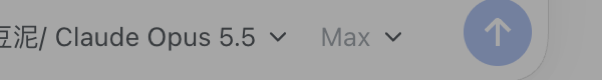

# dsh-model-provider-prefix



对话框的模型控件拆成两个钮：`供应商/模型` 一个、推理强度一个。Composer model seat, split into a `provider/model` trigger and a separate reasoning-effort trigger.

对话框里的模型控件，分成和 ZCode 一样的两个钮：

- **模型钮**：显示 `供应商/模型`（同色、紧排，`/` 属于供应商那一段）。点开后是一张**两栏卡片**：左边供应商列表，右边就是当前指着的那家的模型列表——鼠标停在（或点击）某个供应商上，右栏立刻换成它的模型，不用点进去再返回。打开时右栏默认是当前正在用的那家。
- **强度钮**：只有当前模型带 `reasoning` 时出现，显示当前推理强度（跟随 `current.reasoningEffort`，没有就用 `reasoning.defaultEffort`，再没有就写 `Default`），点开是强度列表。

两个钮各自弹出自己的卡片，卡片锚在各自的钮上，点外部或 `Esc` 关闭。右栏按鼠标悬停的供应商解析（`groupById`），所以指着非当前供应商时看到的一定是那家的模型。

安装名沿用 `dsh-model-provider-prefix`（历史名字），但 0.2.0 起不再往 `conversation.input.right` 里塞前缀格子，而是**顶替**官方那个模型座位。

## 它是怎么挂上去的

`conversation.input.model` 是单占位槽位（session scope），官方 `ui-model-selection` 用默认优先级 `0` 注册。本插件用 `priority: -1` 注册同名字位——槽位规则是「同 id 不同 priority 即遮蔽，最低者渲染」，于是官方座位让位，本插件渲染。

用真实数据面（`modelDirectories.directoryFor(sessionId)`），所以它和 `/model` 命令看到的是同一份目录、同一份当前选择；在任一处切换，另一处立刻同步。

## 目录结构

| 文件 | 作用 |
| --- | --- |
| `index.js` | Host 端空插件，只为让 profile 的 bundle 层出现本包的行，`dsh.client` 才能被发现 |
| `client/client.js` | 浏览器端：注册 `conversation.input.model`（priority `-1`），渲染两个钮 + 弹出卡片 |
| `cordis.patch.yml` | bundle patch 层，插入本包的行 |
| `test/client.test.mjs` | 离线检查：manifest、遮蔽注册、目录数据契约、菜单行规则、CSS token |

浏览器端只 `require` 基线模块（`react`、`react-dom`），样式用宿主 token（`--dsw-alias-*`、`--dsw-radius-*`、`--dsw-menu-surface-fill`、`--dsw-elevation-prominent`），没有硬编码颜色，也不依赖宿主内部实现。

## 数据面

```js
inject: (sessionId) => ({
  available,            // sessions.subagentAddress(sessionId) === undefined
  directory,            // modelDirectories.directoryFor(sessionId).store
  load(),               // directory.load()
  select(selection),    // directory.select({ provider, model, reasoningEffort? })
})
```

- 选模型时带上该模型 `reasoning.defaultEffort`（和官方座位一致），所以换模型不会把强度留在上一个模型的值上。
- 目录加载失败的供应商不会消失，而是以带回重试的行出现在供应商列表末尾，点它重跑 `load()`。
- 被寻址的 subagent 会话（`subagentAddress` 有值）不可选模型：不发起目录 RPC，`select` 直接返回空。

## 安装

三种方式任选其一。装完都要**重启 DeepSeek Harness 应用**——bundle 行在 Host 侧重新组装，只刷新页面不够。

```sh
DSH="/Applications/DeepSeek Harness.app/Contents/Resources/runtime/cli/bin/dsh"

# 1. 直接从 GitHub 装（不需要 npm）
"$DSH" plugin --profile desktop add github:zszz3/dsh-model-provider-prefix

# 2. 用打包好的压缩包，或仓库 Release 的直链
"$DSH" plugin --profile desktop add ./dsh-model-provider-prefix-0.2.2.tgz
"$DSH" plugin --profile desktop add https://github.com/zszz3/dsh-model-provider-prefix/releases/download/v0.2.2/dsh-model-provider-prefix-0.2.2.tgz

# 3. 本地目录（开发时，link: 挂载，改代码即时生效）
"$DSH" plugin --profile desktop add /Users/you/learnspace/dsh-model-provider-prefix
```

卸载：

```sh
"$DSH" plugin --profile desktop remove dsh-model-provider-prefix
```

## 测试

```sh
node --check client/client.js
node --test test/client.test.mjs
```

## 已知限制

- 菜单行目前只有鼠标和 `Esc`，没有 ↑/↓/Enter 键盘导航（官方座位有）。
- 菜单文案写死中文（`供应商`、`模型`、`推理强度`、`搜索模型`），没接 locale 命名空间，英文界面下同样是中文。
- 视觉上仍是「尽量贴近」，不是逐像素复刻 ZCode。
